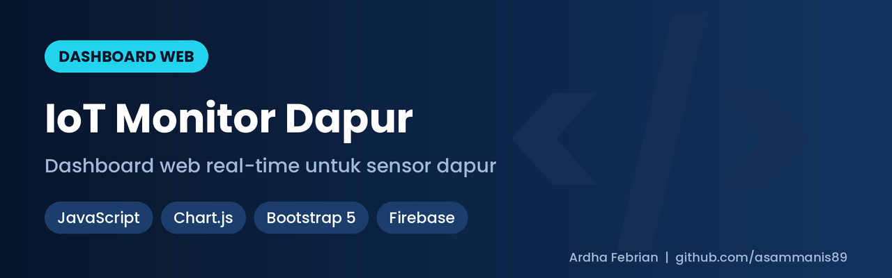
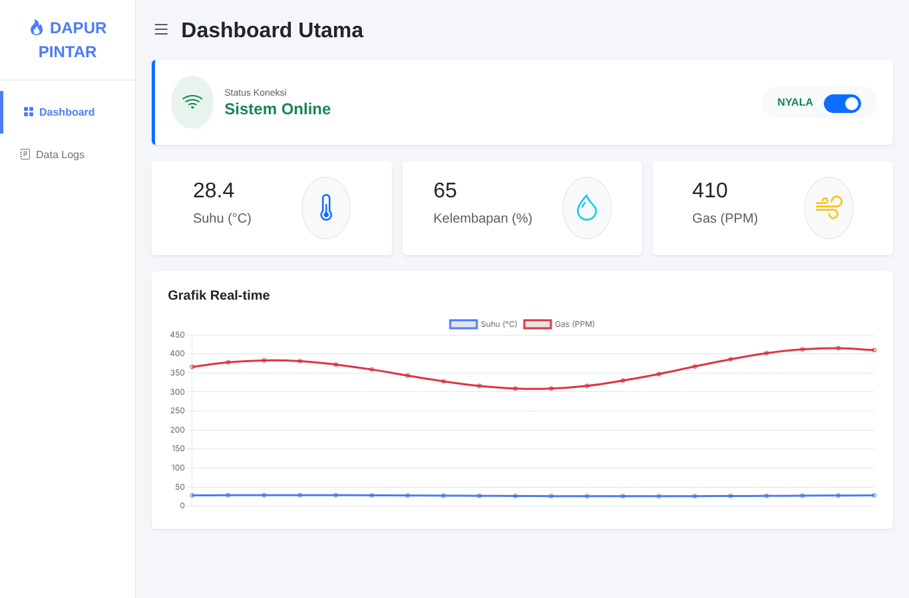
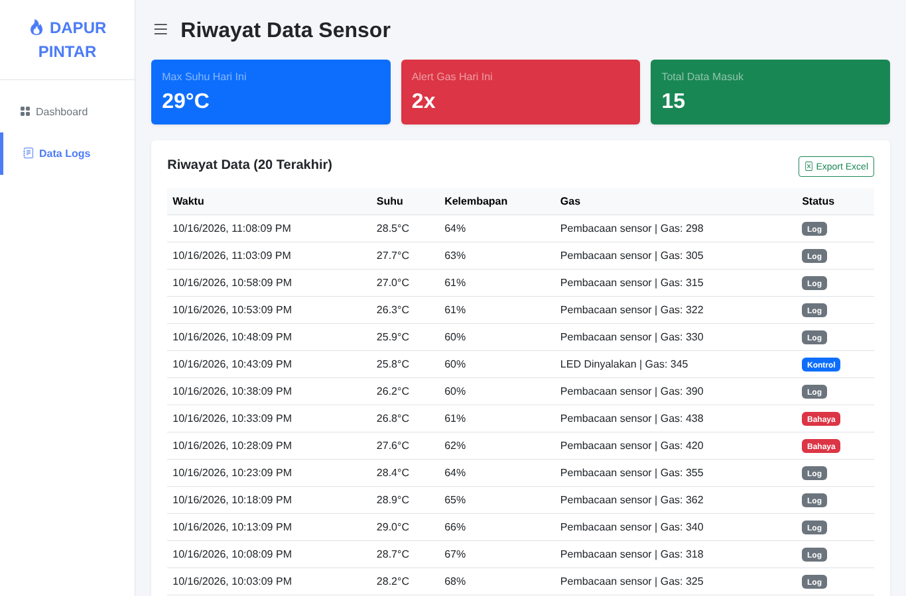

# IoT Monitor Dapur – Dashboard Web

Dashboard web ringan untuk memantau sensor dapur (**suhu, kelembapan, gas**) secara real-time dari **Firebase Realtime Database**, dengan grafik tren dan log kejadian.


*Dashboard utama: status koneksi, nilai sensor, grafik real-time*


*Riwayat data sensor dengan penanda bahaya gas*

<sub>Screenshot memakai data simulasi.</sub>

## Fitur

- Nilai sensor langsung: suhu, kelembapan, gas, dan status perangkat.
- **Grafik real-time** (Chart.js) yang menampilkan 20 data terakhir.
- **Log kejadian**: suhu tertinggi dan jumlah peringatan gas (ambang > 400 PPM).
- Tampilan responsif dengan Bootstrap 5.

## Tech stack

HTML · CSS · JavaScript · Bootstrap 5 · Chart.js · Firebase Realtime Database

## Struktur data Firebase

```
Dapur/Suhu · Dapur/Kelembapan · Dapur/Gas · Dapur/Status
logs/
```

## Cara menjalankan

1. Salin konfigurasi Firebase proyekmu ke `assets/js/firebase-config.js`.
2. Buka `index.html` memakai server statis, misalnya `npx serve .` atau ekstensi Live Server.

> Kunci web Firebase memang bersifat publik. Yang melindungi data adalah **aturan Realtime Database**, jadi pastikan `.read`/`.write` tidak terbuka untuk semua orang.

## Pengembang

**Ardha Febrian Muqorrobin** – WhatsApp 081217529861 · [LinkedIn](https://www.linkedin.com/in/ardha-febrian-342317289/)
